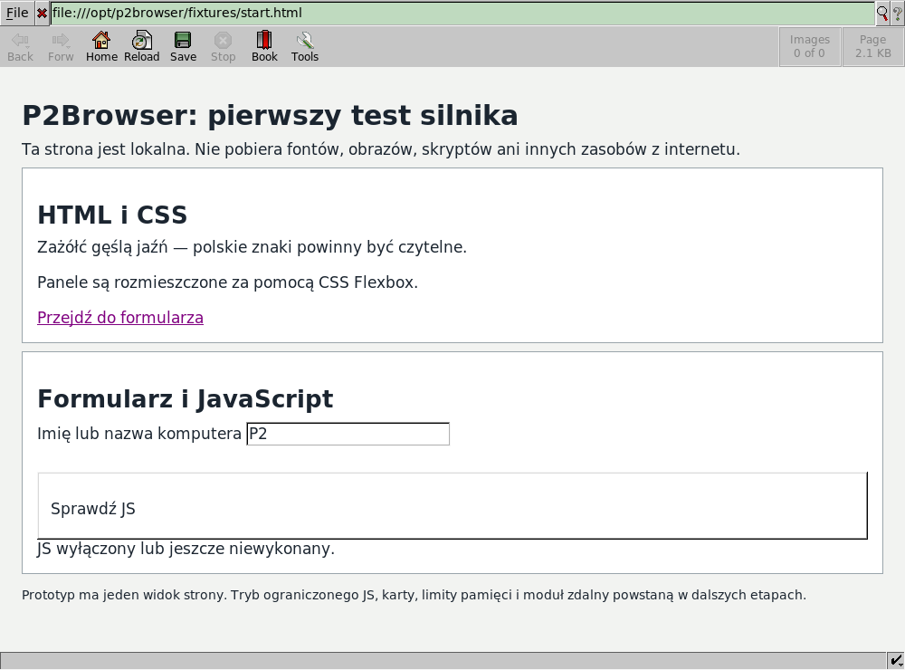
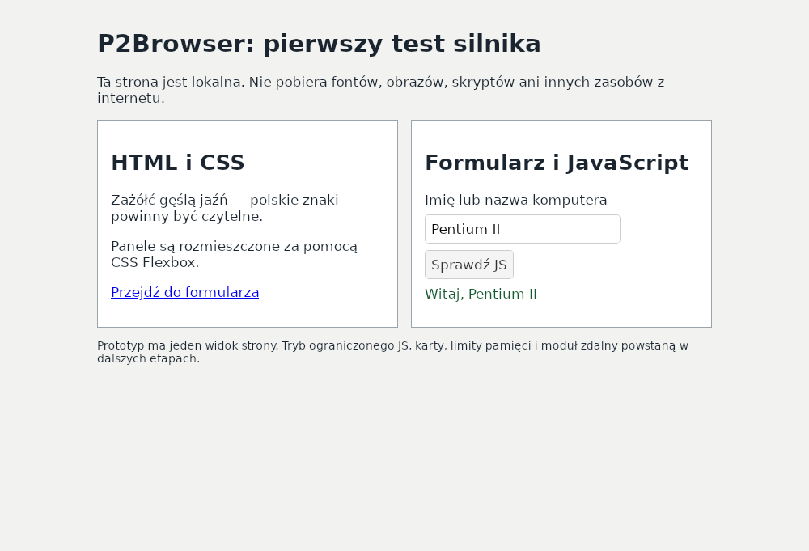

# Dillo i WebKitGTK w emulowanym Pentium II

Data: 8 listopada 2026 r. Pełny gość Debian 12 i386 uruchomił obie
przeglądarki i wyświetlił lokalną stronę. WebKitGTK przeszedł także test
formularza JavaScript i CSS Flexbox, z włączonym sandboxem.

## Warunki próby

- QEMU TCG 7.2.22, jeden CPU `pentium2`: Deschutes, rodzina 6/model 5,
  bez SSE, SSE2 i trybu 64-bitowego.
- RAM nominalny 384 MiB; `MemTotal` gościa 373076 KiB. Swap aktywny
  podczas prób: 524284 KiB, czyli plik 512 MiB pomniejszony o nagłówek.
- Debian 12 Bookworm i386, kernel `6.1.0-54-686` z pakietu `6.1.190-1`.
  Rzeczywisty system plików ext4 na emulowanym dysku IDE, własny skrypt PID 1,
  Xvfb 1000×740, prywatne magistrale sesji D-Bus, bez menedżera pulpitu.
- Gość nie ma karty sieciowej. Loopback służy wyłącznie lokalnemu IPC,
  m.in. pomocnikom DPI Dillo. Test nie łączy się z serwisami internetowymi.
- Aplikacje działają jako `p2test`. Katalog `/run/user` ma 0755,
  a `/run/user/1000` ma 0700 i właściwego właściciela. Sandboxu WebKit
  nie wyłączano.
- Obie przeglądarki otwierają ten sam `fixtures/start.html`. W prototypie
  automatyczne obrazy pozostają wyłączone; strona testowa nie zawiera
  obrazów ani zasobów zewnętrznych. Drugi wariant dodaje pełny JS silnika.

Użyte wersje: Dillo `3.0.5-7+b1`, WebKitGTK i JavaScriptCore
`2.50.6-1~deb12u2`, GTK `3.24.38-2~deb12u3`, GLib `2.74.6-2+deb12u9`,
glibc `2.36-9+deb12u14`, bubblewrap `0.8.0-2+deb12u1`.
Kod C prototypu 0.1.1 nie był zmieniany; kompilacja i386 używa
`-march=pentium2 -mno-sse -mno-sse2 -mfpmath=387`.

## Wyniki pamięci

Każda osobna próba pamięci dostarczyła 15 próbek obejmujących około 30 s,
z odstępem około 2 s. Podajemy największe zaobserwowane wartości, także
z okresu uruchamiania. Są to próbki, nie gwarantowane szczyty pomiędzy nimi.

| Wariant | Największa suma PSS | Największa suma RSS | Procesy w drzewie | VmSwap |
| --- | ---: | ---: | ---: | ---: |
| Dillo 3.0.5 | 7612 KiB ≈ **7,4 MiB** | 12760 KiB | 4 | 0 KiB |
| P2Browser/WebKitGTK, JS wyłączony | 161268 KiB ≈ **157,5 MiB** | 288828 KiB | 9 | 0 KiB |
| P2Browser/WebKitGTK, JS silnika włączony | 162358 KiB ≈ **158,6 MiB** | 293352 KiB | 9 | 0 KiB |

PSS było dostępne dla wszystkich wybranych procesów we wszystkich próbkach.
Pomiary obejmują przeglądarkę, jej pomocników i małego nadzorcę C, który
zatrzymuje w drzewie także odłączone procesy DPI. Nie obejmują oddzielnych
Xvfb, D-Bus, monitora ani całego systemu. Zrzuty list procesów po każdej
próbie potwierdzają posprzątanie pomocników przed kolejną przeglądarką.

PSS proporcjonalnie dzieli strony współdzielone; suma RSS liczy je wielokrotnie.
PSS obejmuje też strony plikowe, które kernel może później odzyskać.
`MemAvailable` jest inną miarą i nie należy dodawać go wprost do PSS.
Brak VmSwap w tych próbkach nie jest testem zachowania pod presją pamięci.

## Potwierdzone działanie strony

**Dillo:** oceniony zrzut pokazuje treść, polskie znaki, pola formularza
i odnośnik. Panele są ułożone pionowo; układ Flexbox autora nie jest
odtworzony. Dillo nie wykonuje JS. Proces został celowo zatrzymany po 35 s;
status `TIMED_STOP` nie oznacza awarii. Pole zdarzenia `load_finished`
w surowym podsumowaniu dotyczy instrumentacji WebKit i nie potwierdza
ładowania w Dillo; tutaj dowodem jest oceniony obraz z właściwą treścią.

**WebKitGTK:** obie próby pamięci zapisały zakończenie ładowania.
Osobne testy renderowania z JS wyłączonym i włączonym zakończyły się sukcesem.
Test JS wpisał `Pentium II`, nacisnął przycisk i sprawdził wynik
`Witaj, Pentium II`, tytuł dokumentu i styl `display: flex`.
Zrzut obszaru strony potwierdza układ dwóch paneli i wynik formularza.

## Weryfikacja narzędzi i aplikacji

- Host budowania: 26 testów zaliczonych — 14 diagnostyki, 9 pakowania
  i 3 nadzorcy procesów. Sześć testów aplikacji było tam pominiętych.
- Pełny gość i386: wszystkie 6 testów aplikacji zaliczonych, w tym CLI,
  ochrona istniejących raportów, renderowanie, formularz JS oraz pomijanie
  prywatnej treści wyjątku JS w dzienniku.
- Dodatkowe dwa testy self-test w głównym porównaniu mają wynik `PASS`.
- Ostatnia próba zakończyła się kodem 0, markerem `P2FULLDONE` i poprawnym
  wyłączeniem gościa. Dziennik kernela tej próby nie wykazuje OOM,
  SIGILL, SIGTRAP ani błędów segmentacji.

Wstępne próby wykryły błędy konfiguracji gościa: niedostępny katalog
nadrzędny sesji i wyłączony loopback. Zostały poprawione przed pomiarem
opisanym powyżej. Nie traktujemy wcześniejszych pustych okien i awarii
uruchamiania sandboxu jako wyniku porównania silników.

## Odtwarzanie i granice wniosku

Kod oraz polecenia opisuje [instrukcja pełnego systemu](../emulation/FULL-SYSTEM.md).
Wykonaną próbę uruchomiono z aktualnymi skryptami zamontowanymi tylko do
odczytu. Runner kopiuje je do nowego, nieuruchomionego dysku przez debugfs,
sprawdza ich bajty i zachowuje SHA-256. Pozwala to poprawiać konfigurację
testów bez ponownego instalowania całej dystrybucji. Biblioteki i binarium
przeglądarki w porównaniu pozostały takie same.

Raport inwentaryzacji powstaje przed aktywacją swapu. Jego początkowe
`SwapTotal=0` nie opisuje późniejszych prób: aktywację 524284 KiB potwierdzają
`/proc/swaps` i dane monitora. Surowe logi i dyski pozostają lokalne w `build/`;
opublikowano kod, agregaty w tym raporcie i dwa obrazy własnej strony testowej.
Paczki i archiwa wydania 0.1.1 w `dist/` nie były przebudowywane.

Wynik potwierdza działanie tej wersji WebKitGTK i386 na lokalnym dokumencie
w profilu instrukcji P2 z 384 MiB RAM. Dillo ma znacznie mniejszy koszt,
przy ograniczeniach CSS i braku JavaScript. Ten pojedynczy dokument
nie rozstrzyga zgodności ani kosztu współczesnych aplikacji internetowych.
QEMU nie odwzorowuje szybkości 400 MHz, ATI Rage Pro ani rzeczywistego
dysku i pulpitu. Potrzebne pozostają próby na fizycznym komputerze.

WebKitGTK Bookworm zakończył wsparcie bezpieczeństwa. Dalszy rozwój musi
rozwiązać aktualizowany port bez SSE2, zanim zatwierdzimy go jako silnik
docelowego programu. Szczegóły i źródła: [ocena wykonalności](p2-feasibility.md).
